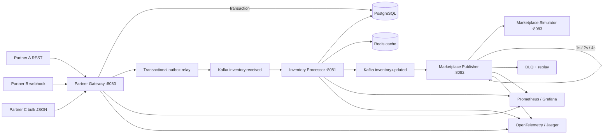
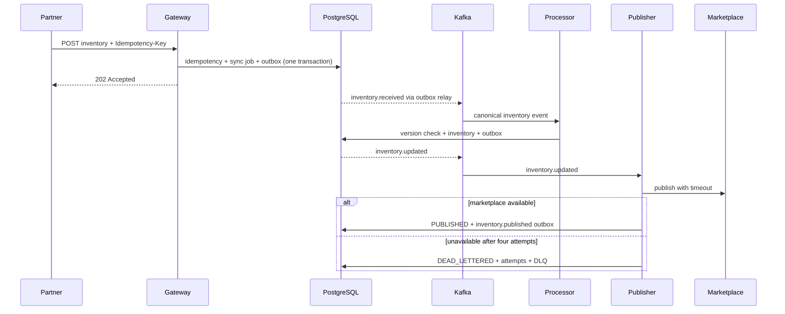
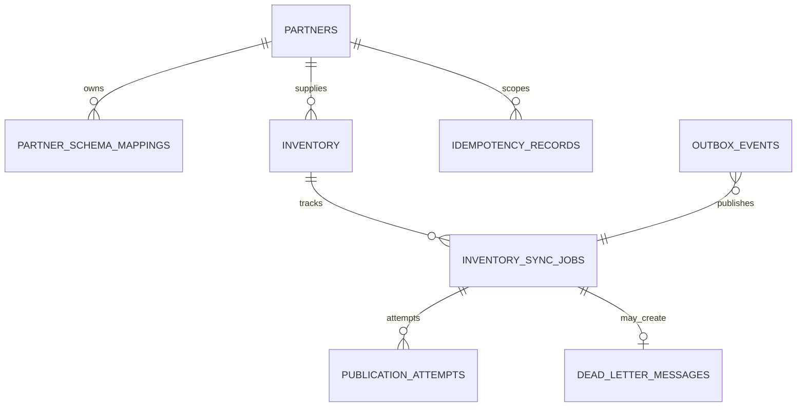

# OpenSync

OpenSync is an AI-assisted, event-driven partner inventory synchronization platform built with Java and Spring Boot. It accepts heterogeneous inventory formats from external partners, normalizes them into a canonical ticket model, and reliably publishes updates through Kafka-based processing pipelines.

The system demonstrates idempotency, out-of-order event handling, optimistic locking, transactional outbox, exponential retries, dead-letter queues, distributed tracing, and LLM-assisted schema mapping. The default `mock` LLM provider requires no API key.

## Architecture





## Modules

| Module | Responsibility |
|---|---|
| `shared-contracts` | Canonical inventory, event envelope, statuses, errors, LLM contracts |
| `shared-persistence` | JPA entities, repositories, PostgreSQL Flyway migrations |
| `partner-gateway` | REST APIs, API keys, rate/payload guards, normalization, idempotency, outbox, AI endpoints |
| `inventory-processor` | Kafka consumption, validation, stale/duplicate detection, optimistic updates, Redis cache |
| `marketplace-publisher` | Timed HTTP publishing, retry, attempt history, DLQ |
| `marketplace-simulator` | Deterministic/random downstream failure and latency simulation |
| `integration-tests` | Testcontainers + REST Assured end-to-end scenarios |
| `load-tests` | k6 steady and traffic-spike workloads |

## Technology

Java 21, Spring Boot 3.5, Spring Web, Data JPA, Validation, Kafka, Retry, Actuator, PostgreSQL 16, Redis 7, Flyway, Micrometer, Prometheus, Grafana, OpenTelemetry, Jaeger, JUnit 5, Mockito, Awaitility, REST Assured, Testcontainers, Docker Compose, OpenAPI 3.

## Quick start

Requirements: Docker Desktop/Engine with Compose v2. The first build downloads Maven and container dependencies.

```bash
cp .env.example .env
# Set ADMIN_API_KEY and GRAFANA_PASSWORD in .env
docker compose up --build
```

Endpoints:

| Service | URL |
|---|---|
| Swagger UI | http://localhost:8080/swagger-ui.html |
| Gateway health | http://localhost:8080/actuator/health |
| Marketplace simulator | http://localhost:8083 |
| Grafana | http://localhost:3000 |
| Prometheus | http://localhost:9090 |
| Jaeger | http://localhost:16686 |

Demo API keys are BCrypt hashes in the seed migration. Their local-only plaintext values are `partner-a-demo-key`, `partner-b-demo-key`, and `partner-c-demo-key`; replace the seed strategy outside a demo environment.

## API examples

Partner A:

```bash
curl -i -X POST http://localhost:8080/api/v1/partners/partner-a/inventory \
  -H 'Content-Type: application/json' \
  -H 'X-API-Key: partner-a-demo-key' \
  -H 'Idempotency-Key: demo-a-001' \
  -H 'X-Correlation-Id: corr-demo-001' \
  --data @samples/partner-a.json
```

Partner B uses different names and cents, but reaches the same canonical shape:

```bash
curl -i -X POST http://localhost:8080/api/v1/partners/partner-b/inventory \
  -H 'Content-Type: application/json' \
  -H 'X-API-Key: partner-b-demo-key' \
  -H 'Idempotency-Key: demo-b-001' \
  --data @samples/partner-b.json
```

Other endpoints include bulk ingest, inventory lookup, sync-job lookup, partner errors, mapping preview/approval, failure explanation, and DLQ replay. Import [`postman/OpenSync.postman_collection.json`](postman/OpenSync.postman_collection.json) for a runnable collection.

## Reliability design

### Idempotency

`partner_id + idempotency_key` is unique in PostgreSQL. The first response is stored for 24 hours and returned verbatim on retries. The inventory consumer independently treats the same source version as `DUPLICATE_IGNORED`, so Kafka redelivery is safe.

### Ordering and concurrency

The processor compares `source_version` per `partner_id + partner_listing_id`. Lower versions become `STALE_REJECTED`; equal versions are duplicates. JPA `@Version` maps to `entity_version` and prevents concurrent consumers from silently overwriting one another.

### Transactional outbox

Ingress writes the sync job, idempotency result, and `inventory.received` outbox row in one transaction. Inventory persistence and `inventory.updated` use the same pattern. A relay marks events published only after Kafka acknowledges them.

### Retry and DLQ

Marketplace calls have connect/read timeouts. Spring Retry performs four total attempts with waits of 1, 2, and 4 seconds. Each attempt uses an independent transaction. Exhausted messages retain their sanitized diagnostic context in `dead_letter_messages`; admin replay sends the original `inventory.updated` envelope again.

## Database



Flyway creates `partners`, `partner_schema_mappings`, `inventory`, `inventory_sync_jobs`, `idempotency_records`, `outbox_events`, `dead_letter_messages`, and `publication_attempts`. PostgreSQL is the source of truth; Redis is only a rate-limit/result/cache accelerator.

## LLM-assisted onboarding

Set `LLM_PROVIDER=mock|openai|anthropic`. `mock` is the default. Provider credentials are read only from environment variables.

```bash
curl -X POST http://localhost:8080/api/v1/partners/partner-b/schema-mappings/preview \
  -H 'Content-Type: application/json' -H 'X-API-Key: partner-b-demo-key' \
  --data @samples/partner-b.json
```

LLM output is never executable code and never enters the inventory pipeline directly. Before `PUT /schema-mappings`, the service enforces enum-based allowed transformations, required canonical fields, JSON-path restrictions, a sample transformation, and `X-Approved-By` human approval. The failure-explanation endpoint is read-only and redacts key/secret/token fields.

## Security

- Partner API keys are BCrypt hashes; admin APIs use a separate environment-provided key.
- Constant-time admin-key comparison, Redis fixed-window partner throttling, and a configurable 1 MiB payload limit are enabled.
- Error responses omit stack traces; AI diagnostics sanitize likely credential fields.
- HMAC webhook verification and request timestamp enforcement are documented future hardening for real partner contracts.

## Testing

```bash
./mvnw test                 # unit tests
./mvnw verify               # includes Testcontainers integration test
```

The end-to-end test covers normal publish, duplicate webhook, stale update, marketplace outage/DLQ, and recovery/replay. It uses PostgreSQL, Kafka, and Redis containers and skips explicitly when Docker is unavailable. Unit tests cover Partner A/B mapping, cents conversion, seat quantity, duplicate/stale decisions, and invalid AI transformations.

## Load testing

```bash
k6 run -e SCENARIO=steady -e PARTNER_API_KEY=partner-a-demo-key load-tests/opensync.js
k6 run -e SCENARIO=spike  -e PARTNER_API_KEY=partner-a-demo-key load-tests/opensync.js
```

Two k6 scenarios are included: a steady 100 rps / 5 min run and a 100→1,000 rps spike. Benchmark results are not published yet; when they are, they will be exported from k6/Grafana together with the machine specification.

## Walkthrough

1. Send Partner A and B samples, then query their canonical inventory.
2. Resend the same idempotency key and show the same `requestId` with no second update.
3. Send version 12 followed by 11 and show `STALE_REJECTED`.
4. Set simulator failure mode to `{ "enabled": true, "failureRate": 1.0, "latencyMs": 500 }`; watch retries and DLQ metrics.
5. Disable failure mode, replay the DLQ message, and show `PUBLISHED` plus the Jaeger trace.
6. Preview Partner B schema mapping and show `DIVIDE_BY_100`, validation, transformed sample, and human approval.

## Observability

Logs use ECS structured JSON and include service/trace context plus correlation MDC. Kafka listener/template observations propagate traces. The provisioned Grafana dashboard contains ingestion/processing/publishing rates, failures, DLQ activity, and latency quantiles. Capture real Swagger, Grafana, and Jaeger screenshots after running the stack; they are not checked in yet.

## Trade-offs and future work

- The demo shares one PostgreSQL schema and persistence library to keep local operation inspectable. Production services should own schemas and exchange only versioned events.
- The outbox relay is hosted by Gateway and polls rows; production can use row locking/leases or CDC such as Debezium.
- Add HMAC timestamped webhooks, per-partner mapping-specific enum tables, secret-manager integration, schema registry compatibility checks, and a Partner C polling connector.
- Add partition-key hot-spot tests, multi-region conflict policy, retention/compaction policies, and real load-test evidence.
- A frontend is intentionally omitted; Swagger, Grafana, and Jaeger expose the backend behavior directly.

## License

Released under the [MIT License](LICENSE).
